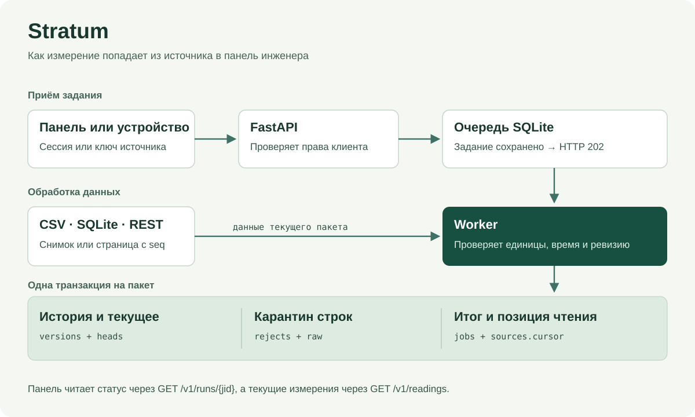

# Stratum

**Бэкенд SaaS-платформы для экологических измерений промышленных площадок.** Лаборатория выгружает протоколы в CSV, шумомер ведёт локальный архив SQLite, сеть опорных станций отдаёт данные по REST, а передвижной пост отправляет события через webhook. В одном рабочем пространстве инженер видит результаты загрузок, актуальные измерения и историю исправлений.

Учебный проект «SaaS-платформа для сбора информации с различных источников данных», осенний семестр 2026/2027. Бэкенд и интеграции — **Евгений Славкин**. Предметная область, источники и данные стенда придуманы для демонстрации.

## Запустить локально

Нужны Python 3.9–3.12, доступ к PyPI для установки и свободный порт 8000. Из каталога проекта выполните команды для macOS или Linux.

```sh
python3 -m venv .venv
source .venv/bin/activate
python -m pip install -r requirements.txt
python -m scripts.demo
```

В Windows PowerShell создайте окружение через `py -m venv .venv` и используйте `.\.venv\Scripts\python.exe` вместо `python` в двух последних командах.

1. Откройте [Swagger UI](http://127.0.0.1:8000/docs). Дождитесь обработки четырёх стартовых загрузок, обычно это занимает несколько секунд.
2. Откройте локальный файл `.demo/demo-login.txt`. Возьмите пароль строки с `workspace=ural` и `login=editor`. В Swagger выполните `POST /v1/session` с полями `workspace`, `login`, `password`.
3. Скопируйте значение `access_token` в **Authorize → HTTPBearer**. Выполните `GET /v1/overview`. На новом стенде в `ural` будут **4 источника, 7 актуальных измерений и 1 отклонённая строка**.
4. Для проверки разграничения доступа войдите как `ural/viewer`, затем как `volga/editor`. Первый аккаунт видит те же данные и может их читать. Во втором пространстве список источников пуст.

Демо поднимает API, отдельный процесс обработки и локальный имитатор REST-поставщика. Остановка — Ctrl+C. Каталог `.demo` сохраняет базу, исходные файлы и случайные пароли между запусками. Чтобы получить чистый стенд, запустите `python -m scripts.demo --data .demo-new --port 8001`. Учётные данные останутся на машине владельца стенда.



## Что передать команде

| Кому | Материал | Что с ним сделать |
| --- | --- | --- |
| Фронтенд | [Карта экранов и запросов](docs/frontend.md) · [клиент для браузера](frontend/stratum.mjs) | Собрать вход, обзор, управление источниками, журнал и экран измерений |
| Вся команда | [OpenAPI 3.1](docs/openapi.json) | Импортировать контракт в Postman или Insomnia, посмотреть модели и ответы |
| Пользователь | [Сценарий работы и демонстрации](docs/user-guide.md) | Проследить одну пробу от загрузки до исправленного результата |
| Интеграции | [Регламент подключения](docs/sources.md) | Подготовить новый источник и проверить первую загрузку |
| Бэкенд и защита | [Архитектура, гарантии и замер](docs/architecture.md) | Объяснить курсор, повторы, блокировки и пределы масштабирования |

## Стек и проверка

FastAPI обслуживает запросы, SQLite в режиме WAL хранит данные и очередь. Обработчики используют стандартные драйверы CSV, SQLite и HTTP. Спецификация генерируется из маршрутов и Pydantic-моделей.

```sh
python -m pip install -r requirements-test.txt
python -m unittest discover -v
python -m scripts.benchmark
python -m scripts.export_api
```

## Отдельный экземпляр

Для пустого экземпляра с раздельными процессами предусмотрен [Compose](compose.yaml). В корне проекта выполните команды ниже. Утилита создания пользователя запросит пароль интерактивно.

```sh
docker compose up --build -d
docker compose exec api python -m scripts.admin ural evgeniy --role editor
```

API доступен на loopback-порту 8000. Оба контейнера используют один именованный том `/data`. Webhook можно создать сразу, для опрашиваемых источников оператор размещает файл привязок и исходные данные по [регламенту](docs/sources.md). Для общего стенда на сервере нужны постоянный локальный диск и HTTPS-прокси перед API. Разрешённые адреса фронтенда задаёт `STRATUM_ORIGINS` в окружении процесса API, через запятую без пробелов. Исходная конфигурация разрешает `http://localhost:5173` и `http://127.0.0.1:5173`.

Эквивалент без контейнеров — из активного окружения запустить `python -m scripts.admin ural evgeniy --role editor`, затем в отдельных терминалах `python -m uvicorn stratum.api:app` и `python -m stratum.worker`. Во всех терминалах укажите одинаковый `STRATUM_DATA` или запускайте команды из одного каталога. По умолчанию база находится в `var/`.
