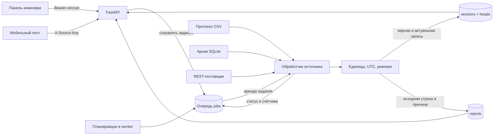

# Как устроен Stratum

За серверную часть в учебном проекте отвечает **Евгений Славкин**. Граница передачи фронтенду проходит по HTTP API. Панель получает идентификатор задания сразу после его постановки в очередь и читает результат независимо от длительности обработки.



Очередь, версии, карантин и курсоры находятся в одной локальной SQLite-базе. API и worker запускаются отдельными процессами. Основные модули — [маршруты](../stratum/api.py), [очередь и транзакция обработки](../stratum/worker.py), [адаптеры](../stratum/connectors.py), [нормализация](../stratum/normalize.py) и [схема БД](../stratum/db.py).

## Три идентификатора

| Идентификатор | За что отвечает | Пример |
| --- | --- | --- |
| seq | Позиция в транспортном журнале конкретного SQLite/REST источника | Строка с seq=105 может исправить измерение недельной давности |
| event_id | Одно наблюдение внутри источника | lab-041 обозначает пробу северного поста |
| revision | Версия содержания этого наблюдения | Версия 2 меняет 23 µg/m³ на 21 µg/m³ |

Первичный ключ истории — `(source_id, event_id, revision)`. В `versions` хранится исходная запись, нормализованные поля и ссылка на задание. В `heads` лежит ссылка на наибольшую принятую ревизию. Версии могут приходить в любом порядке. Повтор сверяется по посту, метрике, времени UTC, нормализованному значению и единице. При разных значениях для одной ревизии запись попадает в карантин. Один и тот же event_id у двух поставщиков обозначает два независимых наблюдения.

## Что происходит при сбое

1. API сохраняет задание, а для webhook ещё и исходный пакет. HTTP 202 возвращается после commit.
2. Worker в короткой транзакции `BEGIN IMMEDIATE` выбирает готовое задание, выдаёт себе случайный токен аренды на 90 секунд и увеличивает номер попытки. На источник одновременно действует одна аренда. Чтение внешней системы проходит за пределами транзакции записи.
3. Перед записью worker проверяет токен и срок аренды. В одной транзакции фиксируются версии, актуальные указатели, карантин, курсор, счётчики и при необходимости следующее задание. Сбой до commit откатывает всю страницу.
4. После истечения аренды другой worker может взять задание. Старый процесс с прежним токеном утрачивает право записи. При ошибке чтения между попытками проходят 2 и 4 секунды. Третья неудача переводит задание в `failed`.
5. Планировщик сохраняет время следующего опроса в базе. После простоя он подбирает просроченные источники. Пропущенные календарные тики объединяются в один опрос, а курсор позволяет дочитать накопившиеся строки у поставщика.

Карантин сохраняет исходную строку и её место в полученной странице. Курсор может пройти бракованную строку только после фиксации карантина. Ошибку структуры всей страницы система отражает на уровне задания и оставляет прежний курсор. Для SQLite и REST полнота зависит от сохранения строк поставщиком до успешного чтения, для CSV — от доступности полного снимка. Повторная доставка webhook может создать дополнительное задание в журнале, а уникальный ключ версии сохраняет одно измерение.

## Разграничение доступа

Рабочее пространство определяется по пользовательской сессии. Привязки, источники, журналы и показания фильтруются по этому пространству. Для запроса к объекту другого клиента API возвращает 404. Редактор управляет потоками, наблюдатель читает результаты. Пароли хешируются PBKDF2-HMAC-SHA256 с индивидуальной солью, в базе хранятся хеши сессионных токенов и ключей webhook. Сессия действует 12 часов. Устройство получает отдельный ключ для одного источника. Клиент выбирает зарегистрированную привязку по имени, а файловые пути, сетевые адреса и секреты внешних систем задаёт оператор.

## Нагрузка и проверка

Воспроизведение из корня проекта после установки `requirements-test.txt`.

```sh
python -m unittest discover -v
python -m scripts.benchmark
```

Локальный контрольный прогон на macOS ARM64, Python 3.9.6, один worker и временная файловая БД. Генератор отправил **20 webhook-пакетов по 500 различных измерений** через FastAPI TestClient, затем worker опустошил очередь. Получилось **10 000 текущих измерений и 20 успешных загрузок**. Приём занял **0,077 с**, обработка **0,208 с**, весь путь **0,285 с**. Из замера исключены генерация входных данных, сеть, TLS и ожидание следующего пробуждения worker. Рабочий SLA требует отдельного замера на целевом оборудовании с согласованным профилем нагрузки.

Интеграционные тесты проверяют четыре канала приёма, повторную доставку, конфликты версий, разграничение доступа, отзыв токена, смену ключа, расписание, повторы и откат посередине страницы. Отдельный тест запускает конкурентный захват задания и проверяет вытеснение прежней аренды.

## Граница масштабирования

Несколько обработчиков могут одновременно читать разные внешние источники. На локальном диске SQLite сериализует запись итогов каждой страницы. Этот вариант подходит для демонстрации и одного серверного узла с постоянным томом. При переходе на несколько узлов потребуются общая серверная БД, распределённый захват заданий и общее хранилище файлов. Во время такой миграции важно сохранить уникальный ключ версии и атомарную фиксацию курсора вместе с результатом.
