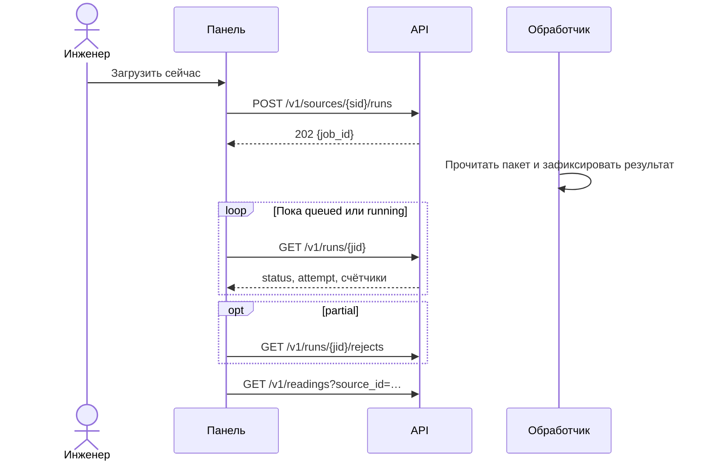

# Фронтенду

Базовый адрес демо — `http://127.0.0.1:8000`. [OpenAPI](openapi.json) содержит полный контракт. [JS-клиент](../frontend/stratum.mjs) работает через встроенный `fetch` и не зависит от UI-фреймворка. Скопируйте модуль в проект, создайте один экземпляр клиента на вкладку. Токен хранится в памяти, после обновления страницы потребуется вход.

## Экраны

| Экран и действие | Запрос | Что отрисовать |
| --- | --- | --- |
| Вход | `POST /v1/session` | Поля workspace, login, password. Из ответа взять роль и срок действия |
| Обзор | `GET /v1/overview` | Источники, текущие измерения, очередь, выполняющиеся задания, неудачные загрузки и число отклонений за всё время |
| Источники | `GET /v1/sources` | Имя, тип, состояние, период, время следующего опроса, курсор |
| Новый источник | `GET /v1/bindings` → `POST /v1/sources` | Пользователь выбирает тип и доступную привязку. Для webhook нужны только имя и тип |
| Настройки | `PATCH /v1/sources/{sid}` | Имя, пауза и период. Запрос отправляет только изменённые поля |
| Ручная загрузка | `POST /v1/sources/{sid}/runs` → `GET /v1/runs/{jid}` | После HTTP 202 показать задание и опрашивать его статус |
| Журнал | `GET /v1/runs?source_id=…&status=partial` | Причина запуска, статус, попытка, счётчики, сообщение об ошибке |
| Карантин | `GET /v1/runs/{jid}/rejects` | Номер строки в пакете с единицы, причина, исходный JSON |
| Восстановление | `POST /v1/runs/{jid}/retry` | Для failed открыть вновь выданный job_id |
| Измерения | `GET /v1/readings` | Время наблюдения, пост, метрика, значение, единица и ревизия |
| Карточка измерения | `GET /v1/sources/{sid}/events/{event_id}/versions` | История сверху вниз по номеру ревизии. По job_id можно открыть породившую её загрузку |
| Ключ устройства | `POST /v1/sources/{sid}/key` | Редактор однократно копирует новый ключ для отправителя. Операция сразу заменяет прежний ключ |
| Выход | `DELETE /v1/session` | Очистить состояние вкладки после HTTP 204 |

### Первый запрос с экрана источников

```js
import { StratumClient } from "./stratum.mjs";

const api = new StratumClient("http://127.0.0.1:8000");
const identity = await api.login("ural", "editor", passwordFromForm);
const sources = await api.sources();
const lab = sources.find(source => source.kind === "csv");
if (identity.role === "editor" && lab?.enabled) {
  const { job_id } = await api.start(lab.id);
  const job = await api.run(job_id);
  console.log(job.status, job.received);
}
```



Интервал опроса на открытой карточке — примерно одна секунда. Остановите таймер после `succeeded`, `partial` или `failed`, а также при уходе со страницы. Маленькая загрузка может завершиться до первого запроса. Для очередной страницы SQLite/REST система создаёт отдельную запись журнала с причиной `continuation`. Список загрузок по источнику покажет всю цепочку.

### Договорённости интерфейса

- **Права.** Для `viewer` доступны обзор и чтение. Кнопки создания, изменения, запуска, выпуска ключа и повтора показывайте роли `editor`. Проверку прав выполняет и сервер.
- **Время.** `created`, `finished`, `next_at`, `expires` — Unix-секунды. Для JavaScript используйте `new Date(seconds * 1000)`. `observed_at` — UTC-строка ISO 8601. Поля `finished` и `next_at` допускают null.
- **Списки.** Источники, загрузки, отклонения, измерения и версии возвращают массивы. Параметры `limit` и `offset` задают размер и начало страницы, по умолчанию 50 и 0, максимум 200 строк. Пустой массив означает пустую страницу. При обновлении живого журнала начинайте с первой страницы.
- **Фильтры измерений.** Поддерживаются `source_id`, `station`, `metric`, `since` включительно и `until` исключительно. Время фильтра относится к наблюдению. По умолчанию новейшее наблюдение идёт первым.
- **Счётчики.** `applied` считает сохранённые версии, включая запоздалые. `skipped` — точные повторы нормализованного содержания одной ревизии. `rejected` — строки карантина. У завершённой обработки сумма равна `received`. Число актуальных измерений выводите из `overview.current_readings`.
- **Пауза.** `{"enabled":false}` останавливает новые поступления и плановые опросы. Уже принятые задания и их последующие страницы завершаются. `{"interval_seconds":null}` оставляет только ручной запуск опрашиваемого источника.
- **Ошибки API.** Текст лежит в `detail`. При 401 покажите вход, при 403 — сообщение о правах. 404 означает отсутствие объекта в текущем пространстве, 409 — недоступное действие, 413 — превышение размера, 422 — ошибку параметров. Сетевая ошибка после отправки webhook допускает повтор с теми же идентификаторами событий.
